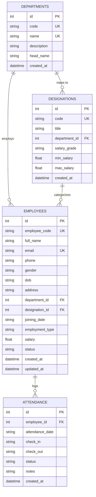

# Employee Management System (EMS)
### Auspify Technologies Software Development Internship Project

An enterprise-grade Human Resource Management System (HRMS) built with **React**, **TypeScript**, **Tailwind CSS**, **FastAPI**, **SQLAlchemy**, and **SQLite**. Designed for workforce administration, department hierarchy, designation pay grades, attendance tracking, and reporting.

---

## 🏛 System Architecture & Technology Stack

| Layer | Technology | Key Features / Libraries |
| :--- | :--- | :--- |
| **Frontend** | React 19 + TypeScript | Vite, Tailwind CSS, Lucide React, Recharts |
| **Backend** | Python 3.10+ FastAPI | Pydantic v2 validation, CORS, Uvicorn |
| **Database** | SQLite + SQLAlchemy 2.0 | Normalized relational schema, Foreign Key Cascades, Indexing |
| **Testing** | Pytest 8.4+ | Automated integration & CRUD test suite (100% passing) |
| **Export Engine** | CSV Stream Generator | Streaming downloads for directories, payroll & attendance |

---

## 🚀 Key Modules & Capabilities

### 1. Executive HR Dashboard
- **Real-Time KPIs**: Total Headcount, Active Staff, Inactive/On-Leave counts, Department count, New Hires this month, Today's Attendance percentage.
- **Interactive Visualizations**:
  - **Workforce Growth Trend**: AreaChart tracking historical monthly hiring cohorts with gradient styling.
  - **Department Distribution**: Donut PieChart and BarChart showing headcount shares and salary budget allocations.
  - **Status & Contract Breakdown**: Progress indicators across Full-Time, Part-Time, Contract, and Intern cohorts.
- **Recent Registrations**: Live table with one-click employee dossier inspection.

### 2. Employee Registration & Management
- **Auto-Generated Employee ID**: Format `AUS-EMP-YYYY-XXX` with sequential uniqueness enforcement.
- **Comprehensive Fields**: Full Name, Email, Phone, Gender, DOB, Address, Department, Designation, Joining Date, Employment Type, Salary, Status.
- **Instant Search & Multi-Filters**: Filter by Department, Role, Employment Status, or Contract Type; sort by salary, name, or joining date.
- **Employee Dossier (Profile Modal)**: View personal, contact, and compensation data alongside the employee's recent attendance history.
- **Status Toggle**: Instant 1-click status switching (`Active` ↔ `Inactive` / `On Leave` / `Terminated`).

### 3. Department Management
- Track organizational divisions with Code (`DEP-ENG`, `DEP-HR`, etc.), Name, Description, Department Head, and Creation Date.
- Automatic computation of enrolled employee count and associated designation roles.
- Safe delete protection and full CRUD.

### 4. Designation & Role Hierarchy
- Define corporate job titles mapped directly to departments.
- Assign pay bands (`L1 - Entry` to `L5 - Executive`) with minimum and maximum annual salary bounds.
- Real-time headcount counters for each designation.

### 5. Attendance & Shift Tracking
- Log daily shift timings (`09:00 AM` - `06:00 PM`), check-in/out stamps, notes, and statuses (`Present`, `Absent`, `Late`, `Half Day`, `On Leave`).
- **Quick-Mark Today**: 1-click automated attendance recording for all active staff.
- Filter by date, specific staff member, or status.
- Direct CSV export for shift logs.

### 6. Executive Reports & Export
- **Employee Directory**: Complete organizational directory.
- **Department Payroll Report**: Breakdown of headcount, active staff ratio, total salary budget, and average salary.
- **New Joiners Cohort**: Filter by 30, 60, 90, 180, or 365 days.
- **Active vs Inactive Personnel Registry**: Compliance breakdown.
- **Attendance Audit Summary**: Shift stats, present vs absent logs, and late arrival counts.
- **CSV & Print Ready**: One-click streaming CSV exports and print formatting.

### 7. Settings & Demonstration Seeding
- Customize organization branding: Company Name, Corporate Tagline, Support Phone, Working Hours, and ID Prefix.
- **1-Click Sample Dataset Reset**: Restores 15+ realistic Auspify Technologies employees across Engineering, HR, Product, Sales, and Finance.

---

## 💾 Database Schema Design

Normalized SQLite database schema with indexes and relationships:



---

## ⚡ Quick Start & Setup Instructions

### Prerequisites
- **Python 3.10+**
- **Node.js 18+ & npm**

### Option A: 1-Click Launcher (Windows)
Double-click:
```bat
start_ems.bat
```
This automatically boots both the backend API and frontend dev server.

---

### Option B: Manual Setup

#### 1. Backend (FastAPI)
```bash
# Navigate to project root
cd d:\EMS

# Install dependencies
python -m pip install -r backend/requirements.txt

# Run backend server
python -m uvicorn backend.app.main:app --host 127.0.0.1 --port 8005 --reload
```
- API Base URL: `http://127.0.0.1:8005`
- Interactive Swagger API Documentation: `http://127.0.0.1:8005/docs`

#### 2. Frontend (React + TypeScript)
```bash
# Navigate to frontend folder
cd d:\EMS\frontend

# Install dependencies (already installed)
npm install

# Start Vite dev server
npm run dev
```
- Web Application: `http://localhost:5175/`

---

## 🧪 Automated Testing

Run the automated backend test suite covering all CRUD, search filters, attendance, and reports:

```bash
python -m pytest backend/tests/test_api.py -v
```

**Results:**
- `test_health` PASSED
- `test_dashboard_stats` PASSED
- `test_departments_crud` PASSED
- `test_designations_crud` PASSED
- `test_employee_crud_and_search` PASSED
- `test_attendance` PASSED
- `test_reports_and_csv_export` PASSED

---

## 📋 API Documentation Summary

| Endpoint | Method | Description |
| :--- | :--- | :--- |
| `/api/health` | `GET` | Health check and system heartbeat |
| `/api/dashboard/stats` | `GET` | Aggregated HR stats, trends, and charts data |
| `/api/employees` | `GET` | Paginated employee list with search, filter, and sorting |
| `/api/employees` | `POST` | Register employee with auto-generated code and validation |
| `/api/employees/{id}` | `GET` | Get employee dossier with recent attendance records |
| `/api/employees/{id}` | `PUT` | Update employee details |
| `/api/employees/{id}/status` | `PATCH` | Quick status toggle (Active/Inactive/On Leave) |
| `/api/employees/{id}` | `DELETE` | Delete employee record |
| `/api/employees/export/csv` | `GET` | Download full employee directory as CSV |
| `/api/departments` | `GET`, `POST` | List and create departments |
| `/api/departments/{id}` | `PUT`, `DELETE` | Update and delete department |
| `/api/designations` | `GET`, `POST` | List and create designations |
| `/api/attendance` | `GET`, `POST` | List and mark attendance |
| `/api/attendance/quick-mark-today` | `POST` | Batch-mark today's shift attendance for active staff |
| `/api/reports/directory` | `GET` | Full employee directory report |
| `/api/reports/departments` | `GET` | Department headcount and budget summary |
| `/api/reports/new-joiners` | `GET` | Recent joiners report (configurable days) |
| `/api/reports/active-inactive` | `GET` | Status breakdown and compensation totals |
| `/api/reports/attendance-summary` | `GET` | Cumulative attendance statistics |
| `/api/reports/export/{type}` | `GET` | Stream CSV file for any report type |
| `/api/settings` | `GET`, `PUT` | Read and update company settings |
| `/api/settings/reset-seed` | `POST` | Restore default Auspify Technologies demo dataset |

---

Developed for **Auspify Technologies Software Development Internship**.
